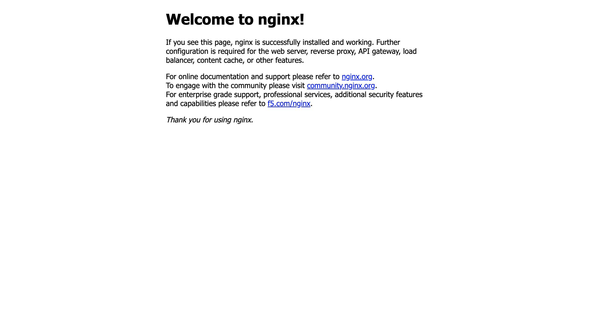

# Exercise 1 – Hello Pod

## Objective

Deploy an Nginx application on Kubernetes using Minikube, expose it through a NodePort Service, and access it through a web browser.

## Environment

- **Operating System:** macOS Monterey 12.7.6
- **Container Runtime:** Docker
- **Kubernetes:** v1.37.0
- **Minikube:** v1.39.0
- **kubectl:** v1.21.4 (client)
- **Application:** Nginx
- **Minikube Driver:** Docker

> Note: The cluster uses Kubernetes v1.37.0, while the installed kubectl client is v1.21.4. These versions have a compatibility gap; updating kubectl is recommended.

## 1. Verify the Installation

Check the installed versions of Docker, kubectl, and Minikube.

```bash
docker --version
kubectl version --client
minikube version
```

Docker, kubectl, and Minikube were installed and available from the terminal.

## 2. Start Minikube

Start the local Kubernetes cluster using Docker as the driver.

```bash
minikube start --driver=docker
```

Minikube downloaded its base image, created the cluster container, configured the Kubernetes networking components, and started the control plane.

The cluster initially reported the node as `NotReady` while Kubernetes components were starting. After initialization, the node reached the `Ready` state.

Verify the cluster:

```bash
minikube status
kubectl get nodes
```

The node was successfully reported as `Ready`, and the Kubernetes API server and kubelet were running.

## 3. Create an Nginx Deployment

Create a Kubernetes Deployment named `hello` using the official Nginx image.

```bash
kubectl create deployment hello --image=nginx
```

Output:

```text
deployment.apps/hello created
```

A Deployment manages the desired number of Pod replicas and helps maintain the application if a Pod fails.

## 4. Verify the Pod

Check the status of the Pod created by the Deployment.

```bash
kubectl get pods
```

Initially, the Pod was in the `Pending` and `ContainerCreating` states while the cluster initialized and the container was prepared.

Monitor the Pod until it is running:

```bash
kubectl get pods -w
```

Final status:

```text
NAME                     READY   STATUS    RESTARTS
hello-64bc89c744-qv8ld   1/1     Running   0
```

The `1/1` READY status indicates that the Pod's single container is ready.


## 5. Expose the Deployment

Expose the Nginx Deployment through a NodePort Service on port 80.

```bash
kubectl expose deployment hello --type=NodePort --port=80
```

Output:

```text
service/hello exposed
```

Verify the Service:

```bash
kubectl get svc
```

The Service was created with type `NodePort`, allowing traffic to reach the Nginx application through the Kubernetes networking layer.

## 6. Access the Application

Generate a local URL for the Service:

```bash
minikube service hello --url
```

Output:

```text
http://127.0.0.1:59300
```

The actual port may differ between runs.
Minikube created a local service tunnel because the Docker driver was being used on macOS. The terminal running the service command needed to remain open while the tunnel was in use.

Opening the generated URL in a web browser displayed the **Nginx Welcome Page**, confirming that the application was accessible.



## 7. Kubernetes Architecture and Working

The basic workflow for creating and accessing the application is:

```text
kubectl
   |
   v
Kubernetes API Server
   |
   v
etcd
   |
   v
Scheduler
   |
   v
Node / Kubelet
   |
   v
Container Runtime
   |
   v
Nginx Container
   |
   v
NodePort Service
   |
   v
Web Browser
```

- **kubectl:** Sends commands and resource requests to the Kubernetes API server.
- **API Server:** Validates requests and provides the Kubernetes control-plane API.
- **etcd:** Stores Kubernetes cluster state and configuration data.
- **Scheduler:** Assigns newly created Pods to suitable nodes.
- **Kubelet:** Ensures that the assigned Pods run as specified.
- **Container Runtime:** Pulls images and runs containers.
- **Nginx:** Serves the default web page on port 80.
- **NodePort Service:** Provides network access to the application through a service port.

## 8. Commands Used

```bash
# Verify tools
docker --version
kubectl version --client
minikube version

# Start the cluster
minikube start --driver=docker

# Verify the cluster
minikube status
kubectl get nodes

# Create and verify the Deployment
kubectl create deployment hello --image=nginx
kubectl get pods
kubectl get pods -w

# Expose the application
kubectl expose deployment hello --type=NodePort --port=80
kubectl get svc

# Access the application
minikube service hello --url
```

## 9. Result

The Nginx application was successfully deployed on a local Kubernetes cluster using Minikube.

The Kubernetes node reached the `Ready` state, the Nginx Pod reached `Running`, and a NodePort Service was created. The generated local URL successfully displayed the Nginx Welcome Page in the browser.

**Therefore, the objective of Exercise 1 was achieved.**