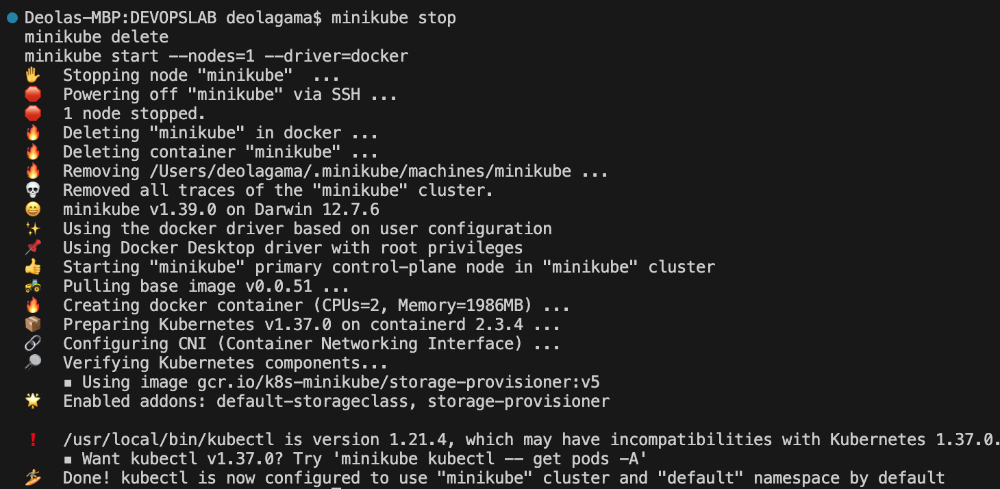
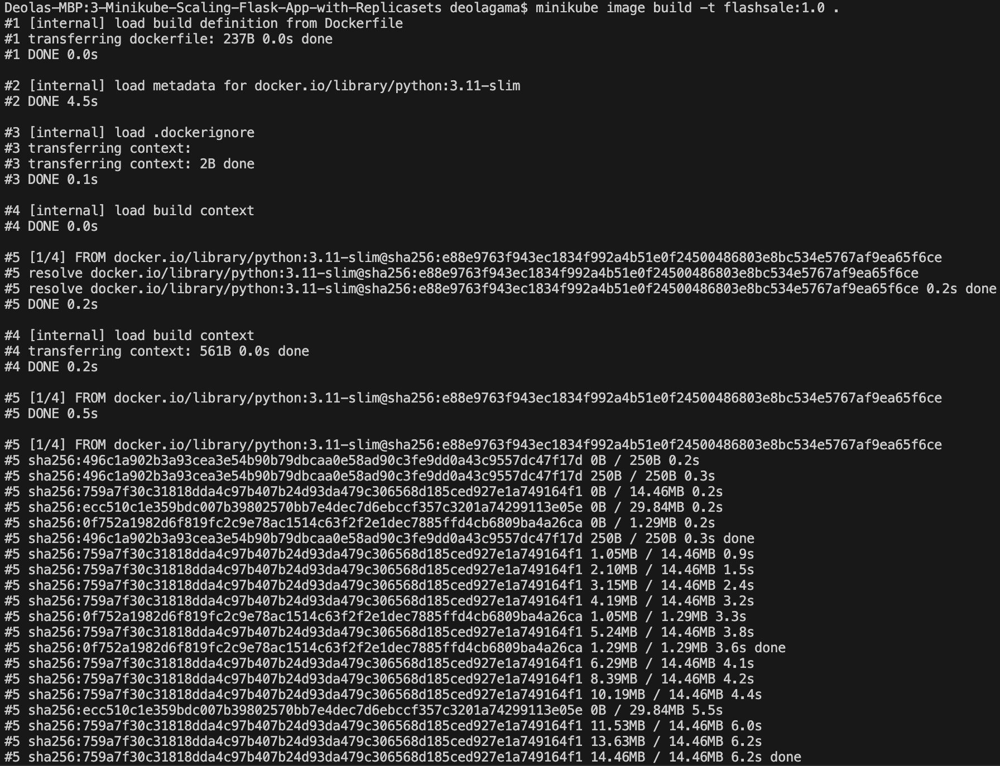
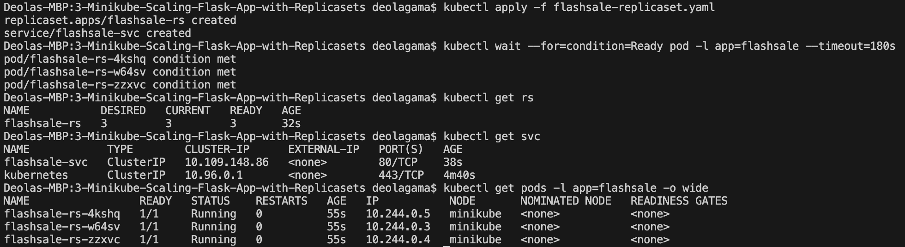
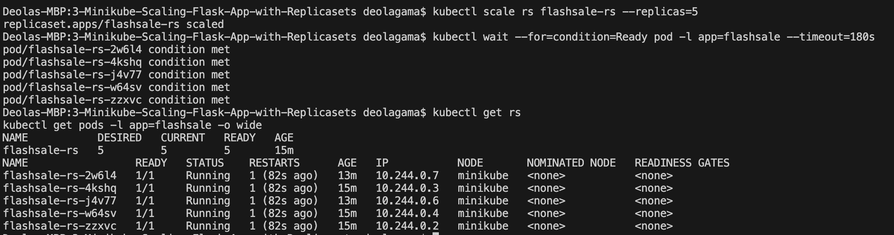
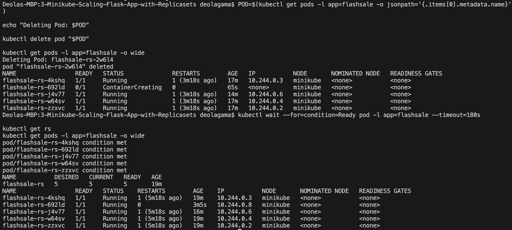
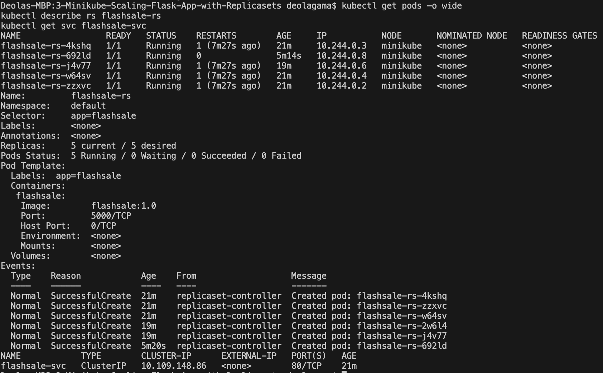
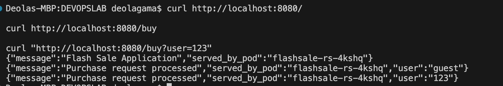

# Exercise 3 – Scaling a Flask Application on a Single Node Using ReplicaSets

## Objective

Deploy a Flask application on Kubernetes using Minikube and a ReplicaSet. Start with three replicas, scale the application to five Pods, demonstrate Pod self-healing by deleting a Pod, and access the application through a Kubernetes ClusterIP Service using port-forwarding.

## Environment

- **Operating System:** macOS Monterey 12.7.6
- **Architecture:** Intel x86_64
- **Container Runtime:** Docker Desktop
- **Orchestration Platform:** Kubernetes
- **Local Kubernetes Cluster:** Minikube
- **Kubernetes Version:** v1.37.0
- **kubectl Client Version:** v1.21.4
- **Application:** Flask (Python 3.11)
- **Application Server:** Gunicorn
- **Container Image:** `flashsale:1.0`

## Real-Life Use Case: E-commerce Flash Sale

During an e-commerce flash sale, an application may receive a sudden increase in purchase requests. Running multiple replicas helps maintain availability and allows a Kubernetes Service to distribute requests across available Pods.

A ReplicaSet maintains the desired number of Pod replicas. If a Pod is deleted or fails, the ReplicaSet controller creates a replacement. The number of replicas can also be increased or decreased according to workload requirements.

## 1. Minikube Setup

Docker Desktop was started before initializing the Minikube cluster.

The installed tools and Kubernetes environment were checked using:

```bash
uname -m
sw_vers
docker --version
minikube version
kubectl version --client
git --version
```

A fresh, single-node Minikube cluster was started using the Docker driver:

```bash
minikube stop
minikube delete
minikube start --nodes=1 --driver=docker
```

The cluster status was verified using:

```bash
minikube status
kubectl get nodes -o wide
```

The Minikube node runs Kubernetes v1.37.0. The installed `kubectl` client is v1.21.4, which is older than the cluster version. Using a compatible client version is recommended.

### Screenshot: Minikube Setup



## 2. Create the Flask Application

The application was implemented in `app.py` using Flask.

It provides two endpoints:

- **`/`** – Returns a welcome message and the hostname of the Pod handling the request.
- **`/buy`** – Simulates processing a purchase request and returns the supplied user parameter and the serving Pod's hostname.

The application uses `socket.gethostname()` to identify the Pod serving each request.

Example purchase endpoint:

```text
/buy?user=123
```

## 3. Create the Dockerfile

The Dockerfile uses the Python 3.11 slim base image and installs Flask and Gunicorn. It copies `app.py` into the container and starts the application on port 5000.

Gunicorn serves the Flask application inside the container.

## 4. Build the Application Image

The Docker image was built directly into Minikube's image environment:

```bash
minikube image build -t flashsale:1.0 .
minikube image ls
```

The image is named `flashsale:1.0`.

The Kubernetes manifest specifies `imagePullPolicy: Never`, allowing Kubernetes to use the locally available image rather than downloading it from a container registry.

### Screenshot: Application Image Build



## 5. Deploy the ReplicaSet and Service

The Kubernetes resources are defined in `flashsale-replicaset.yaml`.

The manifest creates the following resources:

- **ReplicaSet:** `flashsale-rs`
- **Initial replicas:** 3
- **Container image:** `flashsale:1.0`
- **Container port:** 5000
- **Service:** `flashsale-svc`
- **Service type:** ClusterIP
- **Service port:** 80
- **Target port:** 5000

The resources were created using:

```bash
kubectl apply -f flashsale-replicaset.yaml

kubectl get rs
kubectl get svc
kubectl get pods -l app=flashsale -o wide
```

Initially, the three Pods may appear in `Pending` while Kubernetes prepares their containers. They should eventually reach `Running` status and become ready.

### Screenshot: Initial Three Replicas



## 6. Scale the ReplicaSet from Three to Five Pods

The ReplicaSet was scaled to five replicas using:

```bash
kubectl scale rs flashsale-rs --replicas=5

kubectl wait --for=condition=Ready pod -l app=flashsale --timeout=180s

kubectl get rs
kubectl get pods -l app=flashsale -o wide
```

The expected result is five ready Pods managed by the ReplicaSet.

The desired, current, and ready replica counts can be checked using `kubectl get rs`. The Pod list shows the status and node placement of each replica.

### Screenshot: Scaling to Five Pods



## 7. Demonstrate Pod Self-Healing

A ReplicaSet continuously attempts to maintain the configured number of replicas.

One application Pod was deleted to demonstrate this behavior:

```bash
POD=$(kubectl get pods -l app=flashsale -o jsonpath='{.items[0].metadata.name}')

echo "Deleting Pod: $POD"

kubectl delete pod "$POD"

kubectl get pods -l app=flashsale -w
```

After deletion, Kubernetes should create a replacement Pod to restore the desired replica count.

The replacement Pod has a different name. The `-w` option watches changes to the Pod list in real time. Press `Ctrl+C` to stop watching.

After stopping the watch, verify the final state:

```bash
kubectl wait --for=condition=Ready pod -l app=flashsale --timeout=180s
kubectl get rs
kubectl get pods -l app=flashsale -o wide
```

### Screenshot: Pod Self-Healing



## 8. Inspect Pod Placement and the Service

The following commands display the current Pods, ReplicaSet details, and Service configuration:

```bash
kubectl get pods -o wide
kubectl describe rs flashsale-rs
kubectl get svc flashsale-svc
```

Because the exercise uses a single-node Minikube cluster, all application Pods should be scheduled on the Minikube node.

The ClusterIP Service selects Pods labelled `app=flashsale` and exposes them internally on port 80, forwarding requests to container port 5000.

### Screenshot: Pod Placement and Service



## 9. Access the Application Using Port-Forwarding

The application was made accessible from the local machine using:

```bash
kubectl port-forward svc/flashsale-svc 8080:80
```

This forwards local port 8080 to Service port 80. The port-forward command must remain running while testing.

From a second terminal, test the endpoints:

```bash
curl http://localhost:8080/
curl http://localhost:8080/buy
curl "http://localhost:8080/buy?user=123"
```

The expected responses are JSON objects containing the application message and the serving Pod hostname. The `/buy` endpoint also returns the requested user value.

Example response:

```json
{
  "message": "Purchase request processed",
  "user": "123",
  "served_by_pod": "flashsale-rs-..."
}
```

The hostname above is illustrative. The actual Pod hostname is returned by the running application.

### Screenshot: Flask Endpoint Testing




## 10. How Kubernetes Manages the Application

The application deployment follows this simplified workflow:

```text
kubectl
   |
   v
Kubernetes API Server
   |
   v
etcd
   |
   v
ReplicaSet Controller
   |
   v
Scheduler
   |
   v
Minikube Node
   |
   v
Kubelet and Container Runtime
   |
   v
Flask Container Replicas
   ^
   |
ClusterIP Service provides access to matching Pods
```

1. **kubectl:** Sends commands and resource configuration requests to the Kubernetes API Server.
2. **API Server:** Validates and processes Kubernetes API requests.
3. **etcd:** Stores Kubernetes cluster state and configuration.
4. **ReplicaSet Controller:** Maintains the desired number of Pod replicas.
5. **Scheduler:** Assigns newly created Pods to suitable nodes.
6. **Kubelet:** Ensures that assigned Pods run their containers.
7. **Container Runtime:** Runs the application containers.
8. **ClusterIP Service:** Selects matching Pods and provides a stable internal endpoint for accessing the application.

## 11. Important Commands

### Cluster Setup

```bash
minikube start --nodes=1 --driver=docker
minikube status
kubectl get nodes -o wide
```

### Build the Image

```bash
minikube image build -t flashsale:1.0 .
minikube image ls
```

### Deploy and Inspect Resources

```bash
kubectl apply -f flashsale-replicaset.yaml
kubectl get rs
kubectl get svc
kubectl get pods -o wide
```

### Scale the Application

```bash
kubectl scale rs flashsale-rs --replicas=5
kubectl get rs
kubectl get pods -l app=flashsale -o wide
```

### Test Self-Healing

```bash
kubectl delete pod <pod-name>
kubectl get pods -l app=flashsale -w
```

Replace `<pod-name>` with the name of an existing application Pod.

### Access the Application

```bash
kubectl port-forward svc/flashsale-svc 8080:80
```

### Test Endpoints

```bash
curl http://localhost:8080/
curl http://localhost:8080/buy
curl "http://localhost:8080/buy?user=123"
```

### Cleanup

Stop the port-forward process with `Ctrl+C`, then run:

```bash
kubectl delete -f flashsale-replicaset.yaml
minikube stop
```

## 12. Result

The Flask flash-sale application was deployed on Minikube using a ReplicaSet and a ClusterIP Service.

The initial configuration uses three replicas. Scaling the ReplicaSet to five demonstrates horizontal scaling on a single node. Deleting a managed Pod demonstrates self-healing when Kubernetes creates a replacement to restore the desired replica count.

The application image is built locally and the application can be accessed from the local machine using port-forwarding.

The scaling, self-healing, and endpoint testing results should be verified using the actual terminal output before marking each step as successfully completed.

## 13. Screenshots

The `screenshots/` directory contains terminal screenshots documenting the cluster setup, image build, initial deployment, scaling, self-healing, Service configuration, and application testing.

Expected screenshot files:

```text
screenshots/
├── 01-minikube-setup.png
├── 02-image-build.png
├── 03-initial-replicas.png
├── 04-scaled-to-five.png
├── 05-pod-self-healing.png
├── 06-service-and-pods.png
├── 07-flask-endpoints.png
```

