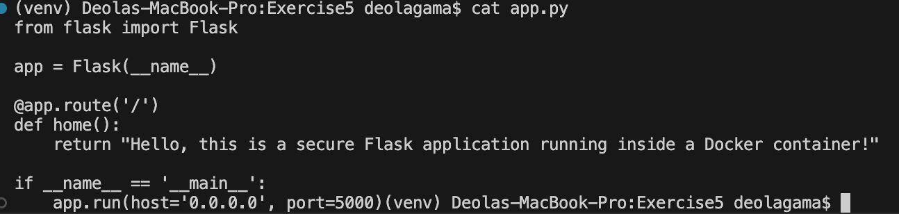
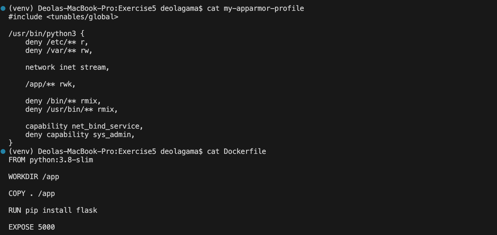
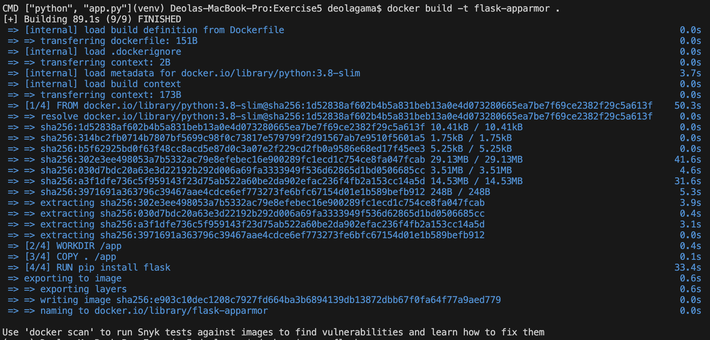
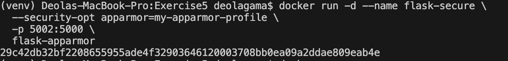
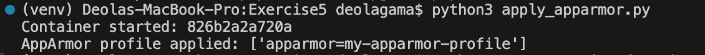
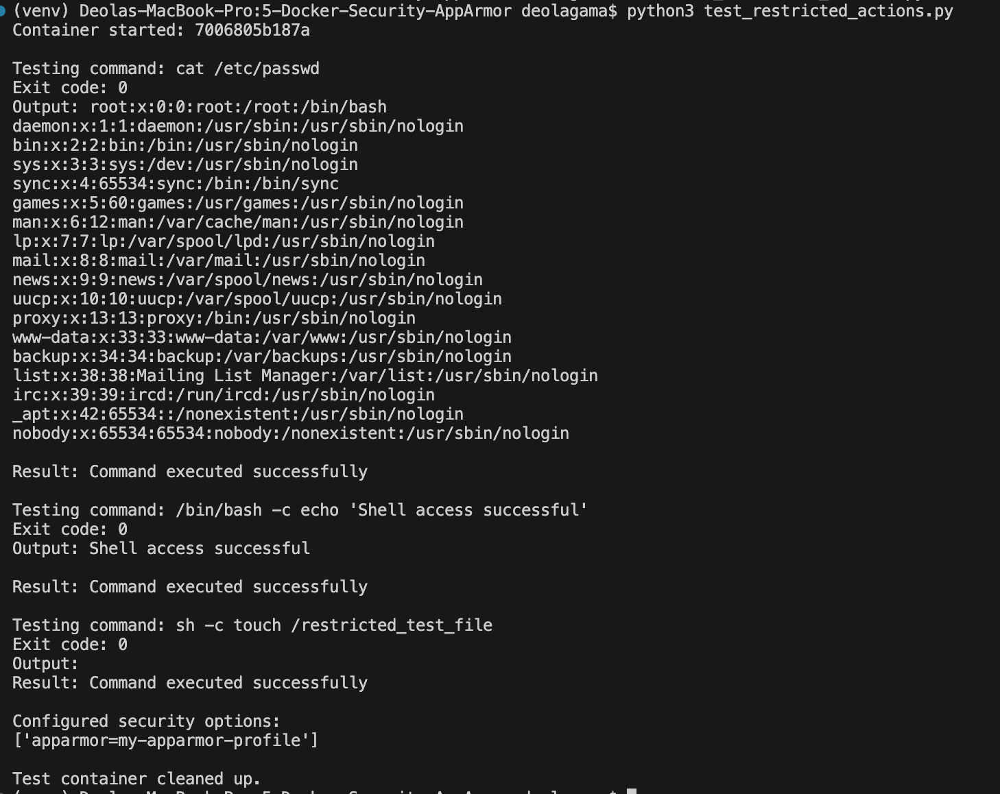
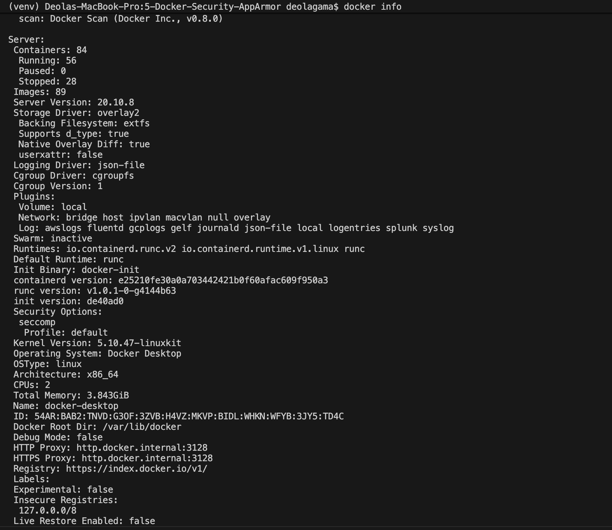

# Exercise 5 – Docker Security with AppArmor and Python

## Aim

To secure a Flask application running inside a Docker container using AppArmor security profiles and the Docker SDK for Python. The exercise demonstrates how container security configurations can restrict access to sensitive files, directories, and system capabilities.

## Technologies Used

- Docker
- Python
- Flask
- Docker SDK for Python
- AppArmor
- macOS with Docker Desktop

## Project Structure

```text
Exercise5/
│
├── app.py
├── Dockerfile
├── my-apparmor-profile
├── apply_apparmor.py
├── test_restricted_actions.py
├── README.md
└── screenshots/
    ├── 01-project-files.png
    ├── 02-flask-app.png
    ├── 03-dockerfile-profile.png
    ├── 04-docker-build.png
    ├── 05-container-running.png
    ├── 06-python-sdk.png
    ├── 07-security-tests.png
    └── 08-security-info.png
```

## 1. Flask Application

The Flask application provides a basic web endpoint that returns a response when accessed.

The application runs on port 5000 inside the Docker container.



## 2. Docker Configuration

A Dockerfile is created using the Python base image. It installs Flask, copies the application files, exposes port 5000, and starts the Flask application.



## 3. AppArmor Security Profile

The `my-apparmor-profile` file defines security restrictions for the application.

The profile specifies access permissions for directories and restricts certain system capabilities and executable paths.

The objective is to limit unnecessary access and improve container security.

## 4. Building the Docker Image

The Docker image is built using:

```bash
docker build -t flask-apparmor .
```



## 5. Running the Docker Container

The container is started with the AppArmor security option:

```bash
docker run -d --name flask-secure \
  --security-opt apparmor=my-apparmor-profile \
  -p 5002:5000 \
  flask-apparmor
```

The Flask application can be accessed at:

http://localhost:5002



## 6. Applying AppArmor Using Python Docker SDK

The `apply_apparmor.py` script uses the Docker SDK for Python to:

- Connect to the Docker daemon.
- Build the Docker image.
- Start a container with the specified AppArmor security option.
- Inspect the container configuration.
- Display the configured security options.



## 7. Testing Restricted Actions

The `test_restricted_actions.py` script attempts operations such as reading `/etc/passwd` and executing `/bin/bash` inside the container.

These tests are intended to demonstrate how security restrictions affect container operations.



## 8. Docker Security Configuration

Docker security options can be inspected using:

```bash
docker info --format '{{.SecurityOptions}}'
```



## 9. Platform Limitation

This exercise was performed on macOS using Docker Desktop.

AppArmor is a Linux kernel security module and is not natively supported by the macOS kernel. Therefore, actual AppArmor enforcement could not be verified in this environment.

Docker Desktop reported its available security options, including the default seccomp profile. The Docker container configuration was also inspected to check the supplied security option.

The results of the restricted-action tests on macOS should not be interpreted as proof of AppArmor enforcement.

For actual AppArmor enforcement, the exercise should be run on a Linux system with AppArmor enabled.

## Conclusion

The exercise demonstrates container security configuration using Docker, AppArmor profile definitions, and the Docker SDK for Python. It also demonstrates how to inspect Docker container security settings and test restricted operations.

The macOS environment allowed the Docker and Python SDK portions to be demonstrated, while actual AppArmor enforcement requires a supported Linux environment.