# Exercise 6 – Grafana Real-Time Monitoring of Quick Commerce App

## Objective

Build a real-time monitoring pipeline for a delivery service. A Python application simulates delivery metrics, Prometheus scrapes them and evaluates alert rules, Grafana visualizes them on a dashboard, and Jenkins automates building and running the metrics application in Docker.

## Environment

| Item              | Value                                      |
|-------------------|--------------------------------------------|
| OS                | macOS (Darwin 12.7.6), Docker Desktop for Mac |
| Shell             | VS Code integrated terminal (bash)         |
| Language          | Python 3.9+ (`prometheus-client`)          |
| Monitoring        | Prometheus, Grafana                        |
| Automation        | Jenkins (LTS) running in Docker            |
| Container Runtime | Docker                                     |

## Project Structure

```
6-Grafana-Realtime-Monitoring-of-Quick-Commerce-App/
├── delivery_metrics.py   # Python script that simulates delivery metrics
├── prometheus.yml        # Prometheus scrape configuration
├── alert_rules.yml       # Prometheus alert rules
├── Dockerfile            # Image for the metrics app (used by Jenkins)
├── Jenkinsfile           # Jenkins pipeline definition
├── README.md
└── screenshots/
```

## Adaptations for macOS

- `--network=host` and `172.17.0.1` do not work on Docker Desktop (containers run inside a Linux VM), so a custom Docker network (`monitoring`) and `host.docker.internal` are used instead.
- The lab used both `alerts_rules.yml` and `alert_rules.yml`; `alert_rules.yml` is used everywhere.
- Volume mounts use `"$PWD/file"` in bash/zsh.
- `sed -i` on macOS needs an empty backup suffix: `sed -i '' ...`.
- The Docker socket is mounted as `/var/run/docker.sock` (the `//var/...` form is only for Windows).
- Use `python3` / `pip3` instead of `py`, and `grep -E` instead of `Select-String`.

> **Prerequisite:** Docker Desktop must be running. Use separate terminal tabs (`Cmd + T` in VS Code: the `+` button) for the Python script, since it keeps running.

---

## 1. Run the Metrics Application

Install the dependency and start the Python script, which exposes metrics on port 8000:

```bash
python3 -m pip install prometheus-client
python3 delivery_metrics.py
```

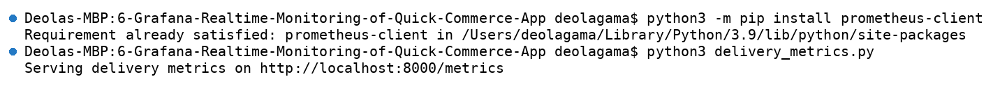

The script simulates these metrics every second:

| Metric                  | Type    | Description                       |
|-------------------------|---------|-----------------------------------|
| `total_deliveries`      | Gauge   | Total number of deliveries        |
| `pending_deliveries`    | Gauge   | Number of pending deliveries      |
| `on_the_way_deliveries` | Gauge   | Number of deliveries on the way   |
| `average_delivery_time` | Summary | Average delivery time in seconds  |

Check the metrics endpoint from a second terminal:

```bash
curl -s http://localhost:8000/metrics | grep -E "deliveries|average_delivery"
```

The endpoint returns the delivery gauges and the Summary's `_count` and `_sum` values. Dividing the sum by the count gives an average delivery time of about 32 seconds.

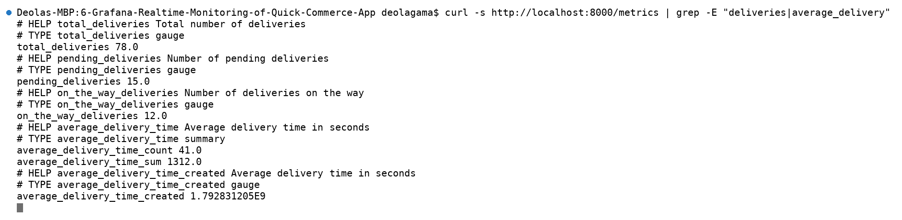

---

## 2. Start Prometheus

Create a Docker network and start Prometheus with the config and alert rules mounted:

```bash
docker network create monitoring

docker run -d --name prometheus --network monitoring -p 9090:9090 \
  --add-host=host.docker.internal:host-gateway \
  -v "$PWD/prometheus.yml:/etc/prometheus/prometheus.yml" \
  -v "$PWD/alert_rules.yml:/etc/prometheus/alert_rules.yml" \
  prom/prometheus
```

Check that it is up:

```bash
curl -s localhost:9090/-/ready
```

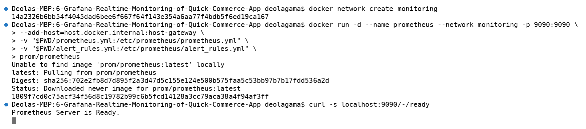

Open <http://localhost:9090/targets> to verify the scrape targets. Both targets show state **UP**:

- `delivery_service` → `http://host.docker.internal:8000/metrics`
- `prometheus` → `http://localhost:9090/metrics`

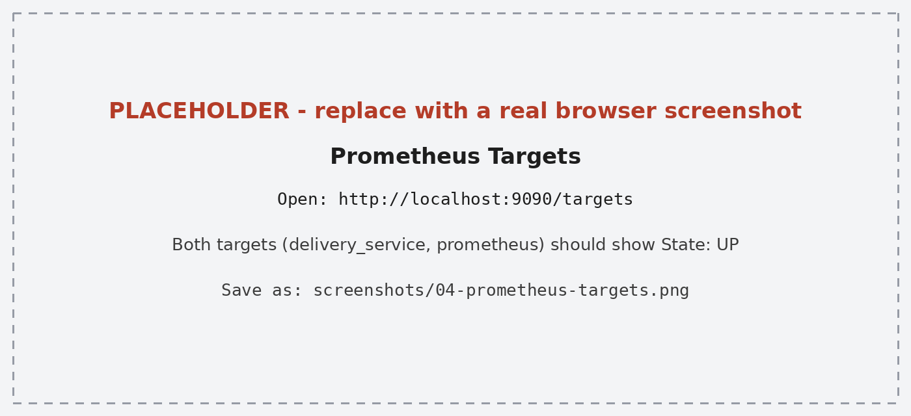

---

## 3. Alert Rules

Two alert rules are defined in `alert_rules.yml`:

| Alert                     | Expression                                                       | Severity |
|---------------------------|------------------------------------------------------------------|----------|
| `HighPendingDeliveries`   | `pending_deliveries > 10` (for 15s)                              | warning  |
| `HighAverageDeliveryTime` | `(average_delivery_time_sum / average_delivery_time_count) > 30` | critical |

Open <http://localhost:9090/alerts>. With the default simulated values, both alerts fire:

- `HighPendingDeliveries` → value 15
- `HighAverageDeliveryTime` → value ~30.56

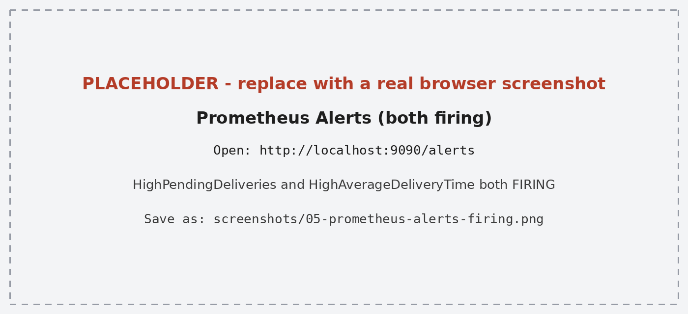

---

## 4. Set Up Grafana

Start Grafana on the same Docker network:

```bash
docker run -d --name grafana --network monitoring -p 3000:3000 grafana/grafana
```

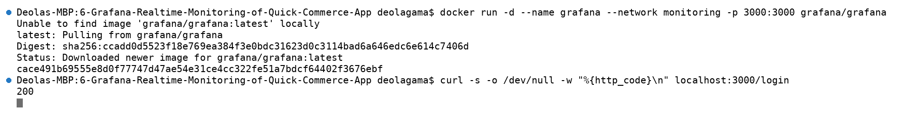

1. Open <http://localhost:3000> and log in with `admin` / `admin`.
2. Go to **Connections → Data sources → Add data source → Prometheus**.
3. Set the URL to `http://prometheus:9090` and click **Save & test**.
4. Create a dashboard with four panels:

| Panel                  | Query                                                    |
|------------------------|----------------------------------------------------------|
| Total Deliveries       | `total_deliveries`                                       |
| Pending Deliveries     | `pending_deliveries`                                     |
| On-the-Way Deliveries  | `on_the_way_deliveries`                                  |
| Average Delivery Time  | `average_delivery_time_sum / average_delivery_time_count` |

The dashboard displays live values, for example Total Deliveries 78, Pending Deliveries 18, On-the-Way Deliveries 12, and Average Delivery Time 29.7s.

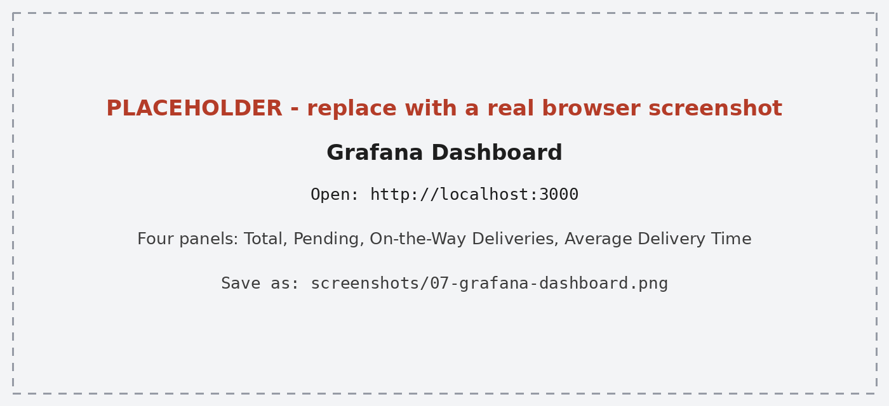

---

## 5. Simulate and Trigger Alerts

To push pending deliveries well above the threshold, change the range in `delivery_metrics.py`. Stop the running script first (`Ctrl + C`), then:

```bash
sed -i '' 's/random.randint(10, 20)/random.randint(50, 100)/' delivery_metrics.py
docker restart prometheus
python3 delivery_metrics.py
```

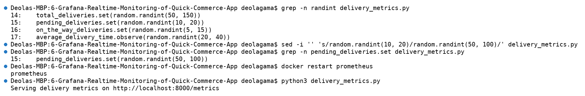

After the change, the alerts show a mixed state:

- `HighPendingDeliveries` → **FIRING** (value 78, severity warning)
- `HighAverageDeliveryTime` → **INACTIVE**, because the average dropped back below 30 seconds

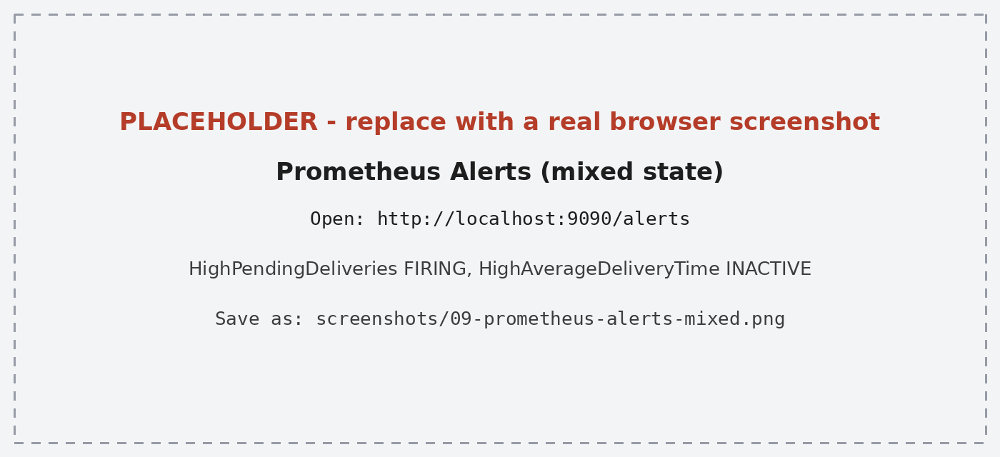

---

## 6. Jenkins Pipeline

The Jenkins pipeline checks Docker, builds the metrics image, and runs it as a container.

```bash
docker run -d --name jenkins -p 8080:8080 -p 50000:50000 \
  -v jenkins_home:/var/jenkins_home \
  -v /var/run/docker.sock:/var/run/docker.sock \
  --user root jenkins/jenkins:lts

docker exec -u root jenkins bash -c "apt-get update && apt-get install -y docker.io"
docker exec jenkins cat /var/jenkins_home/secrets/initialAdminPassword
```

The Docker socket is mounted and the Docker CLI is installed so Jenkins can run `docker` commands against the host's Docker. The last command prints the password for the first login at <http://localhost:8080>.

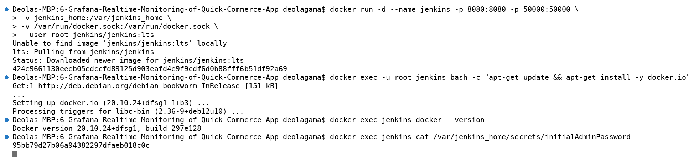

Pipeline job settings:

- **Definition:** Pipeline script from SCM, **SCM:** Git
- **Repository URL:** `https://github.com/lakshyaaa76/DEVOPS.git`
- **Branch:** `*/main`
- **Script Path:** `Exercises/6-Grafana-Realtime-Monitoring-of-Quick-Commerce-App/Jenkinsfile`

> The pipeline runs the container on port 8000. **Stop the local Python script (`Ctrl + C`) before running the build**, otherwise port 8000 is already in use.

### Build Failure and Fix

The first build failed with `failed to read dockerfile: open Dockerfile: no such file or directory`. Jenkins runs commands from the repository root, not the exercise folder. The fix was wrapping the build step in `dir(...)`:

```groovy
stage('Build Docker Image') {
    steps {
        dir('Exercises/6-Grafana-Realtime-Monitoring-of-Quick-Commerce-App') {
            sh 'docker build -t delivery_metrics .'
        }
    }
}
```

After pushing the fix (commit: `Fix Jenkinsfile build path`) and running **Build Now**, build #2 finished with **SUCCESS**.

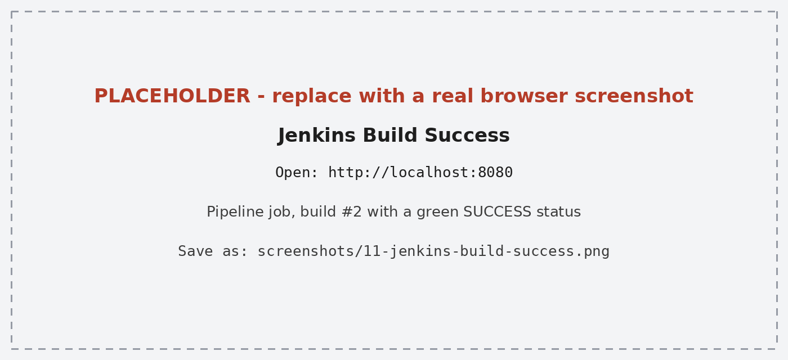

---

## 7. Verify the Running Stack

```bash
docker ps
curl -s http://localhost:8000/metrics | grep "deliveries"
```

Four containers are running: `delivery_metrics`, `jenkins`, `grafana`, and `prometheus`. The metrics endpoint is now served by the container built by Jenkins.

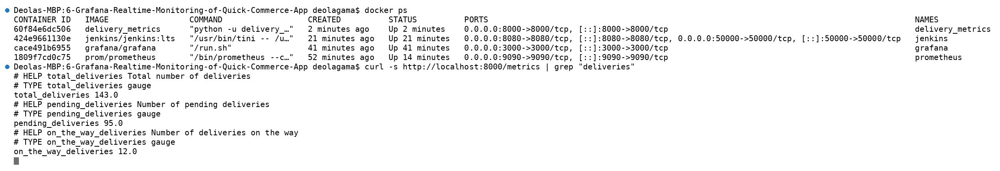

---

## 8. Monitoring Flow

```
delivery_metrics.py (port 8000)
          ↓
Prometheus scrapes /metrics
          ↓
Alert rules evaluated
          ↓
Grafana queries Prometheus
          ↓
Dashboard panels
```

- The Python app exposes metrics through `prometheus_client` on `/metrics`.
- Prometheus scrapes the target at a fixed interval and stores the time series.
- Alert rules are evaluated against the stored metrics and move from Inactive to Pending to Firing.
- Grafana uses Prometheus as a data source and renders the metrics as panels.
- Jenkins automates building and running the metrics application as a Docker container.

---

## 9. Commands Used

```bash
python3 -m pip install prometheus-client
python3 delivery_metrics.py

curl -s http://localhost:8000/metrics | grep -E "deliveries|average_delivery"

docker network create monitoring
docker run -d --name prometheus --network monitoring -p 9090:9090 --add-host=host.docker.internal:host-gateway -v "$PWD/prometheus.yml:/etc/prometheus/prometheus.yml" -v "$PWD/alert_rules.yml:/etc/prometheus/alert_rules.yml" prom/prometheus
docker run -d --name grafana --network monitoring -p 3000:3000 grafana/grafana

sed -i '' 's/random.randint(10, 20)/random.randint(50, 100)/' delivery_metrics.py
docker restart prometheus

docker run -d --name jenkins -p 8080:8080 -p 50000:50000 -v jenkins_home:/var/jenkins_home -v /var/run/docker.sock:/var/run/docker.sock --user root jenkins/jenkins:lts
docker exec -u root jenkins bash -c "apt-get update && apt-get install -y docker.io"
docker exec jenkins cat /var/jenkins_home/secrets/initialAdminPassword

docker ps
```

### Cleanup

```bash
docker rm -f prometheus grafana jenkins delivery_metrics
docker volume rm jenkins_home
docker network rm monitoring
```

---

## 10. Result

The delivery monitoring pipeline was set up successfully. The Python app exposed simulated delivery metrics, Prometheus scraped them with both targets reporting UP, and the alert rules fired and cleared based on the simulated values. Grafana visualized the metrics on a live dashboard, and the Jenkins pipeline built and ran the metrics application as a Docker container after the Dockerfile path issue was fixed.
