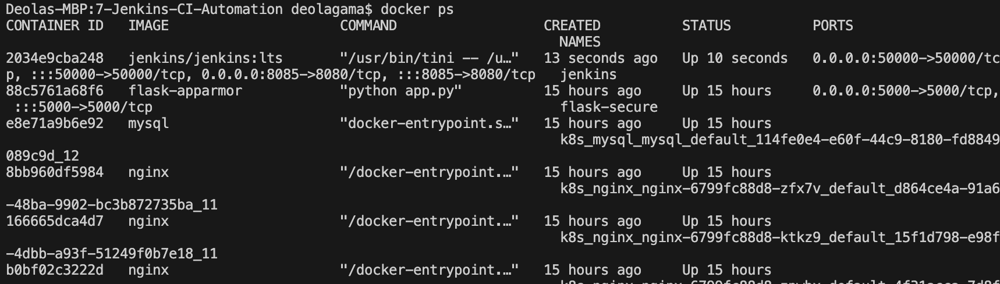
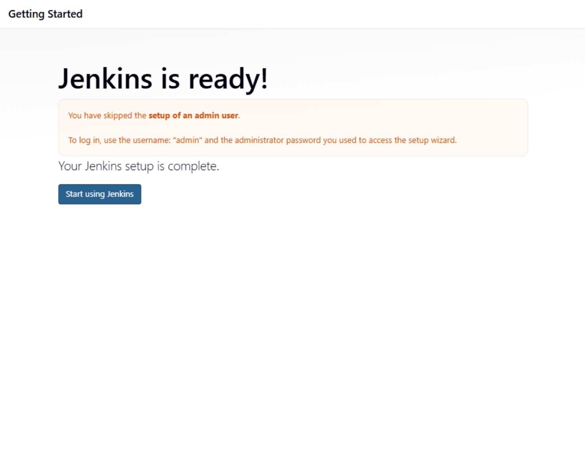
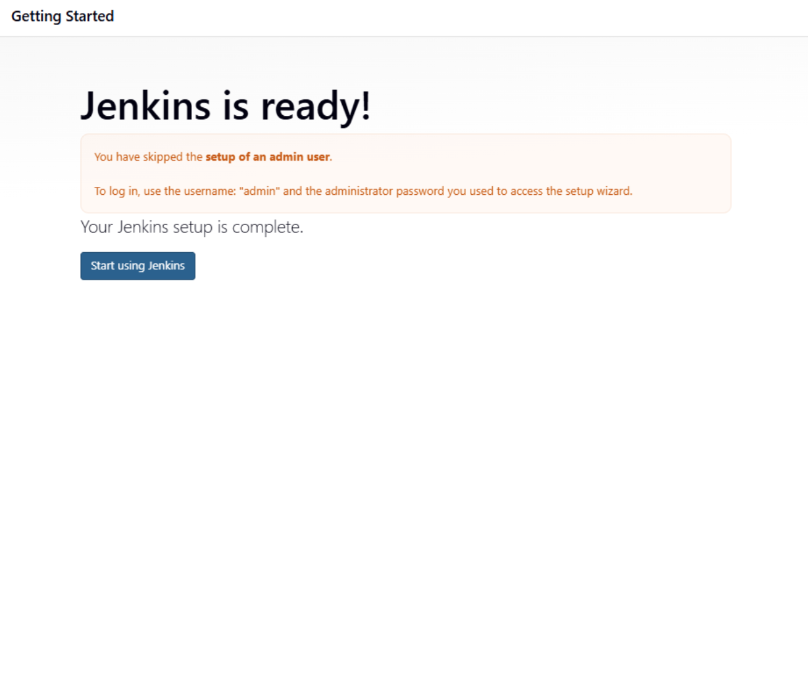
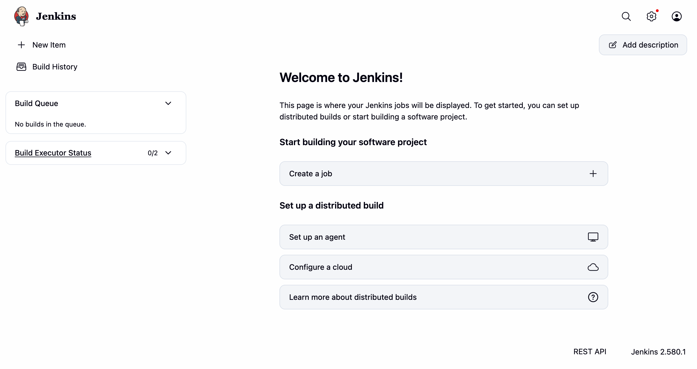

# Exercise 7 – Jenkins CI Automation

## Objective
Understand the concept of Continuous Integration (CI), then install and run Jenkins as a Docker container, unlock it using the initial admin password, and access the Jenkins dashboard through a web browser.

## Environment
- OS: macOS
- Shell: zsh (VS Code terminal)
- Container Runtime: Docker Desktop
- Image: `jenkins/jenkins:lts`
- Jenkins Version: jenkins-core-2.580.1.jar
- Access URL: http://localhost:8085

## Folder Structure
```
7-Jenkins-CI-Automation/
├── README.md
└── screenshots/
```

## 1. What is Continuous Integration (CI)?
Continuous Integration is a development practice where developers frequently integrate their code changes into a shared repository. Each integration triggers an automated build and test run, so errors are detected early and fixed quickly.

**Key features of CI:**
- Frequent code integration into a shared repository.
- Automated builds on every commit.
- Automated testing to ensure existing functionality remains intact.
- Immediate feedback to developers.

**Benefits of CI:**
- Early bug detection, which reduces the cost of fixing bugs.
- Better collaboration on a shared codebase.
- Faster development cycles.
- Higher code quality and fewer regressions.

## 2. What is Jenkins?
Jenkins is an open-source automation server used to build, test, and deploy software. It automates repetitive tasks and enables Continuous Integration (CI) and Continuous Delivery (CD).

**Key Jenkins concepts:**
- **Job/Project:** A task or process that Jenkins runs.
- **Build:** The process of compiling and packaging code.
- **Pipeline:** A series of steps to build, test, and deploy an application.
- **Plugins:** Extend Jenkins' functionality (for example, Git and Docker plugins).
- **Nodes:** Machines where Jenkins runs jobs (controller/agent setup).

## 3. Start Jenkins Using Docker
```bash
docker run -d --name jenkins -p 8085:8080 -p 50000:50000 jenkins/jenkins:lts
```
- Port 8080 is used to access the Jenkins web interface.
- Port 50000 is used by Jenkins agents to connect to the controller.

Docker pulled the `jenkins/jenkins:lts` image and started the container.

## 4. Verify the Container
```bash
docker ps
```
The `jenkins` container shows an `Up` status with ports 8080 and 50000 mapped to the host.



## 5. Get the Initial Admin Password
```bash
docker exec jenkins cat /var/jenkins_home/secrets/initialAdminPassword
```
The command prints the initial admin password required to unlock Jenkins.

## 6. Open Jenkins in the Browser
```bash
open http://localhost:8085
```

## 7. Unlock Jenkins
The Unlock Jenkins screen shows the path of the password file (`/var/jenkins_home/secrets/initialAdminPassword`) and a password box with a Continue button. The initial admin password from Step 5 was entered to unlock Jenkins.



## 8. Complete the Setup
The setup wizard was completed with the suggested plugins. The admin user creation step was skipped, so login is done with the username `admin` and the initial admin password. The "Jenkins is ready!" message was displayed with a Start using Jenkins button.



## 9. Jenkins Dashboard
The Jenkins dashboard opened successfully.
- Sidebar: New Item, Build History, Build Queue (empty), Build Executor Status.
- Main area: Welcome message with options to create jobs or set up distributed builds.
- Jenkins version: 2.580.1.



## 10. Jenkins CI Working
```
Developer
   ↓
Git Repository
   ↓
Jenkins Server
   ↓
Automated Build
   ↓
Automated Tests
   ↓
Feedback (Success / Failure)
```
1. The developer pushes code to the version control system (Git).
2. Jenkins detects the change and triggers a build.
3. The code is compiled and dependencies are resolved.
4. Automated tests are run to verify functionality.
5. The build and test results are sent back to the developer.

## 11. Commands Used
```bash
cd Exercises/7-Jenkins-CI-Automation

docker run -d --name jenkins -p 8085:8080 -p 50000:50000 jenkins/jenkins:lts

docker ps

docker exec jenkins cat /var/jenkins_home/secrets/initialAdminPassword

open http://localhost:8085
```

## 12. Cleanup
```bash
docker stop jenkins
docker rm jenkins
```

## 13. Result
Jenkins was successfully installed and run as a Docker container on macOS. The container started with ports 8080 and 50000 mapped, Jenkins was unlocked using the initial admin password, the setup completed with the "Jenkins is ready!" message, and the Jenkins dashboard was accessed through the browser at http://localhost:8085.
