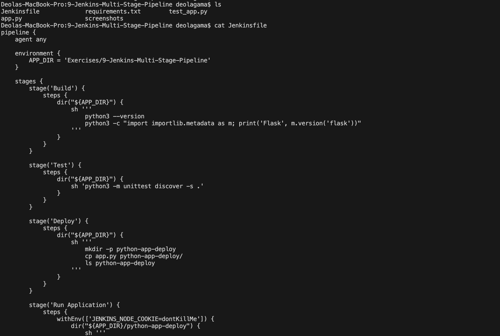
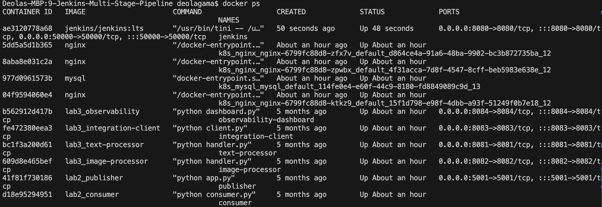
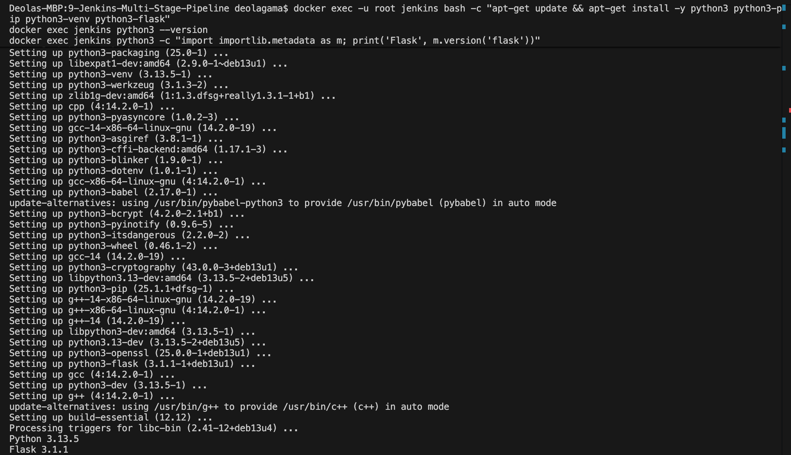
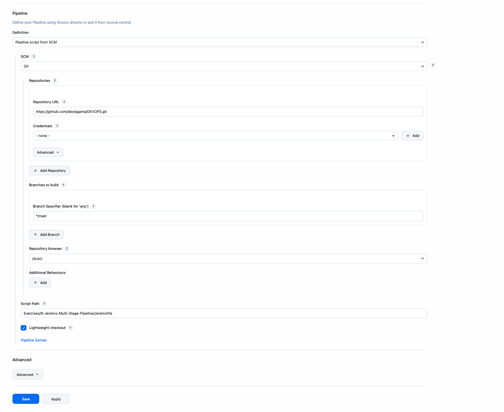
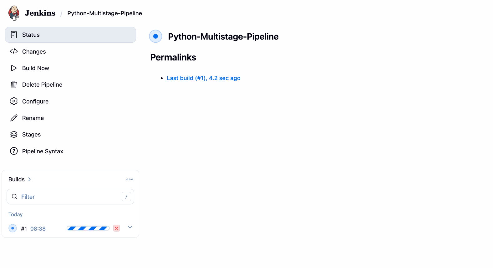
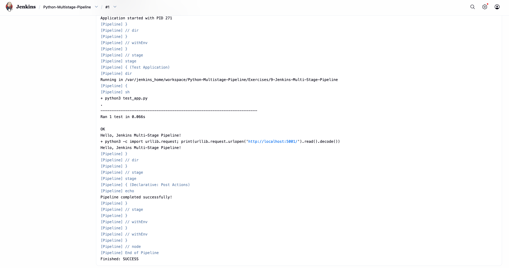
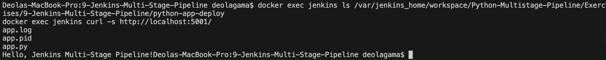

# Exercise 9 – Jenkins Multi-Stage Pipeline

## Objective
Create a Jenkins Pipeline that builds, tests, deploys and runs a Python Flask application using multiple stages, with the pipeline defined in a Jenkinsfile stored in a Git repository.

## Environment
- OS: macOS
- CI Server: Jenkins (LTS) running in Docker
- Container Runtime: Docker Desktop
- Language: Python 3 / Flask
- Source Control: GitHub
- Shell: zsh (VS Code terminal)

## Folder Structure
```
9-Jenkins-Multi-Stage-Pipeline/
├── Jenkinsfile
├── README.md
├── app.py
├── requirements.txt
├── test_app.py
└── screenshots/
```

## 1. Application Files
- `app.py` – a Flask app that returns `Hello, Jenkins Multi-Stage Pipeline!` on `/`.
- `requirements.txt` – pins `flask==2.1.2`.
- `test_app.py` – a unit test that checks the home route returns status 200 and the expected message.

The Jenkinsfile defines five stages. Since the repository contains several exercises, each stage runs inside the exercise folder using `dir(...)`.

| Stage | What it does |
|---|---|
| Build | Checks the Python and Flask installation |
| Test | Runs `python3 -m unittest discover -s .` |
| Deploy | Copies `app.py` into a `python-app-deploy` folder |
| Run Application | Starts the deployed app with `nohup` and saves its PID to `app.pid` |
| Test Application | Runs `test_app.py` and fetches `/` from the running app |

A `post` block prints `Pipeline completed successfully!` on success and a failure message otherwise. The Run Application stage sets `JENKINS_NODE_COOKIE=dontKillMe` so Jenkins does not kill the background app when the build ends.



## 2. Push to GitHub
Jenkins reads the Jenkinsfile from GitHub, so the files were pushed first:
```bash
git add Exercises/9-Jenkins-Multi-Stage-Pipeline
git commit -m "Add Exercise 9 pipeline files"
git push
```

## 3. Start Jenkins
```bash
docker run -d --name jenkins -p 8080:8080 -p 50000:50000 -v jenkins_home:/var/jenkins_home jenkins/jenkins:lts
docker ps
```


## 4. Install Python in the Jenkins Container
The default Jenkins image does not include Python, so the pipeline would fail with missing `python3` errors. The dependencies were installed inside the container:
```bash
docker exec -u root jenkins bash -c "apt-get update && apt-get install -y python3 python3-pip python3-venv python3-flask"
docker exec jenkins python3 --version
```


## 5. Unlock Jenkins
```bash
docker exec jenkins cat /var/jenkins_home/secrets/initialAdminPassword
open http://localhost:8080
```
The password was used to unlock Jenkins, the suggested plugins (including the Pipeline plugin) were installed, and an admin user was created.

## 6. Create the Jenkins Job
1. Click **New Item**, name it `Python-Multistage-Pipeline` and select **Pipeline**.
2. Under Pipeline, set Definition to **Pipeline script from SCM**.
3. Set SCM to **Git** and enter the repository URL.
4. Set Branch Specifier to `*/main`.
5. Set Script Path to `Exercises/9-Jenkins-Multi-Stage-Pipeline/Jenkinsfile`.
6. Click **Save**.



## 7. Run the Pipeline
Click **Build Now**. All five stages completed successfully.



Opening the build and selecting **Console Output** shows:
- Deploy → copied `app.py` into `python-app-deploy`
- Run Application → started `app.py` with `nohup`
- Test Application → ran `test_app.py`, 1 test passed
- The test printed `Hello, Jenkins Multi-Stage Pipeline!`
- The final log showed `Pipeline completed successfully!`
- Status: `SUCCESS`



## 8. Verify the Deployment
```bash
docker exec jenkins ls /var/jenkins_home/workspace/Python-Multistage-Pipeline/Exercises/9-Jenkins-Multi-Stage-Pipeline/python-app-deploy
docker exec jenkins curl -s http://localhost:5001/
```
- `app.py` is the deployed application copy.
- `app.log` holds the output of the running application.
- `app.pid` stores the process ID of the running application.



## 9. Pipeline Flow
```
GitHub Repository
   ↓
Jenkins (Pipeline script from SCM)
   ↓
Checkout
   ↓
Build
   ↓
Test
   ↓
Deploy
   ↓
Run Application
   ↓
Test Application
   ↓
Post Actions (SUCCESS)
```
- Jenkins pulls the repository and reads the Jenkinsfile from the configured script path.
- Each stage runs in order, and the pipeline stops if any stage fails.
- The Deploy stage simulates a deployment by copying the application to a separate directory.
- The Run Application stage starts the deployed app in the background.
- The Post section reports the final result.

## 10. Commands Used
```bash
git add Exercises/9-Jenkins-Multi-Stage-Pipeline
git commit -m "Add Exercise 9 pipeline files"
git push

docker run -d --name jenkins -p 8080:8080 -p 50000:50000 -v jenkins_home:/var/jenkins_home jenkins/jenkins:lts
docker exec -u root jenkins bash -c "apt-get update && apt-get install -y python3 python3-pip python3-venv python3-flask"
docker exec jenkins cat /var/jenkins_home/secrets/initialAdminPassword

docker exec jenkins ls /var/jenkins_home/workspace/Python-Multistage-Pipeline/Exercises/9-Jenkins-Multi-Stage-Pipeline/python-app-deploy
docker exec jenkins curl -s http://localhost:5001/
```

## 11. Cleanup
```bash
docker stop jenkins
docker rm jenkins
```
The `jenkins_home` volume keeps the job, but Python lives inside the container and must be reinstalled after `docker rm`.

## 12. Result
The multi-stage Jenkins pipeline ran successfully. The Flask application was tested, deployed to a separate directory, started in the background, and tested again, and the build finished with status SUCCESS. The deployed files (`app.py`, `app.log`, `app.pid`) were confirmed inside the Jenkins workspace.
